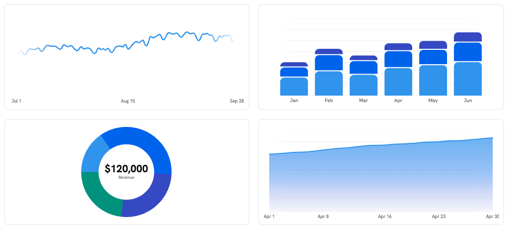

<p align="center">
  <a href="https://opensource.pitant.de/"><picture>
    <source media="(prefers-color-scheme: dark)" srcset="docs/images/pitant-logo-dark.svg">
    
  </picture></a>
</p>

<h1 align="center">PITANT Charts</h1>

<p align="center">React charts for dashboards and a WebGPU-first TypeScript engine for industrial time series.</p>

<p align="center">
  <a href="https://opensource.pitant.de/charts/"><strong>Explore 351 examples</strong></a>
  &nbsp;·&nbsp;
  <a href="https://opensource.pitant.de/charts/#docs=introduction">Documentation</a>
  &nbsp;·&nbsp;
  <a href="#quick-start">Quick start</a>
  &nbsp;·&nbsp;
  <a href="https://github.com/PITANT-Industries/pitant-charts">Star on GitHub</a>
</p>

<p align="center">
  <a href="https://opensource.pitant.de/charts/">
    
  </a>
</p>

## Choose a starting point

| Use case | Start here |
| --- | --- |
| **Build a dashboard** | [`pitant-charts`](packages/charts-ui/README.md) provides typed line, bar, donut, and sunburst components with Recharts and CSS theme tokens. |
| **Plot industrial time series** | [`@pitant/charts`](packages/charts/README.md) includes a WebGPU renderer, a Canvas2D fallback, and worker-backed downsampling. [`@pitant/charts-react`](packages/charts-react/README.md) provides React bindings. |
| **Explore chart types and interactions** | The [interactive catalog](https://opensource.pitant.de/charts/) covers 49 chart families plus Tooltips, including measured-data examples for spectrum, 3D spectral waterfalls, correlation, and process control. The [catalog source guide](apps/chart-catalog/README.md) explains how to build and reuse the examples from `@pitant/chart-catalog`. |

## Quick start

Build a dashboard chart with the `pitant-charts` package. You’ll need [Bun](https://bun.com/) to pack it from source and React and React DOM 19.2 or a later 19.x version in your app.

```sh
git clone https://github.com/PITANT-Industries/pitant-charts.git
cd pitant-charts
bun install --frozen-lockfile
cd packages/charts-ui
bun pm pack
```

From your React app, run `bun add /path/to/pitant-charts-0.7.0.tgz` with the path to the archive printed by `bun pm pack`.

```tsx
import { LineChart } from 'pitant-charts'
import 'pitant-charts/styles.css'

const orders = [
  { month: 'Jan', orders: 28 },
  { month: 'Feb', orders: 41 },
  { month: 'Mar', orders: 35 },
]

export function OrdersChart() {
  return (
    <LineChart
      label="Monthly orders"
      data={orders}
      category={row => row.month}
      series={[{ name: 'Orders', value: row => row.orders }]}
    />
  )
}
```

See the [dashboard component API and theme guide](packages/charts-ui/README.md) for the other components and styling options. For industrial charts, see the [core API](packages/charts/README.md) and the [React bindings](packages/charts-react/README.md).

## Develop locally

Run from the repository root.

```sh
bun install --frozen-lockfile
bun run catalog:dev
```

Common workspace commands are `bun run build`, `bun run test`, `bun run typecheck`, and `bun run lint`. [Getting started](docs/getting-started.md) · [Contributing](CONTRIBUTING.md) · [CI and delivery](docs/ci-cd.md) · [Architecture](ARCHITECTURE.md) · [Changelog](CHANGELOG.md)

## License

PITANT-owned source code is subject to the terms of the Mozilla Public License, v. 2.0. If a copy of the MPL was not distributed with this file, you can obtain one from [Mozilla](https://mozilla.org/MPL/2.0/).

Earlier MIT distributions retain their original terms. The chart archives include the corresponding source and applicable third-party notices. [License](LICENSE) · [Licensing and source access](docs/licensing.md) · [Catalog notices](apps/chart-catalog/THIRD_PARTY_NOTICES.md) · [Dashboard notices](packages/charts-ui/THIRD_PARTY_NOTICES.md)
